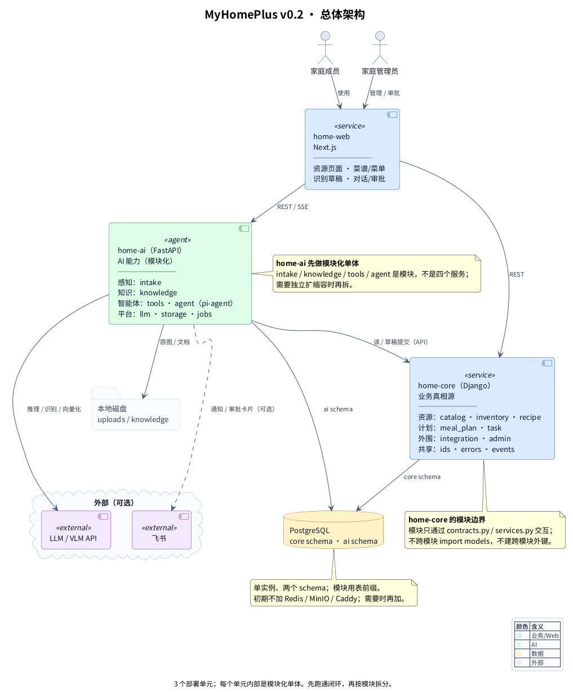
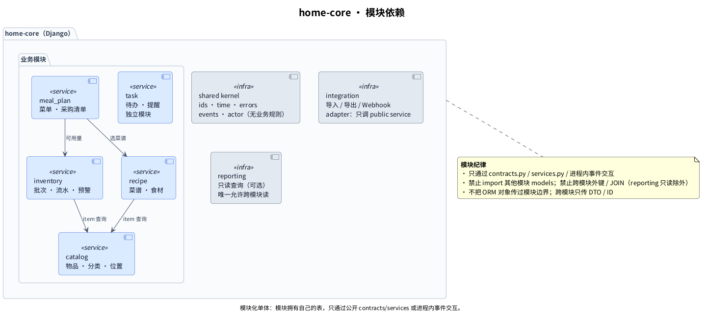
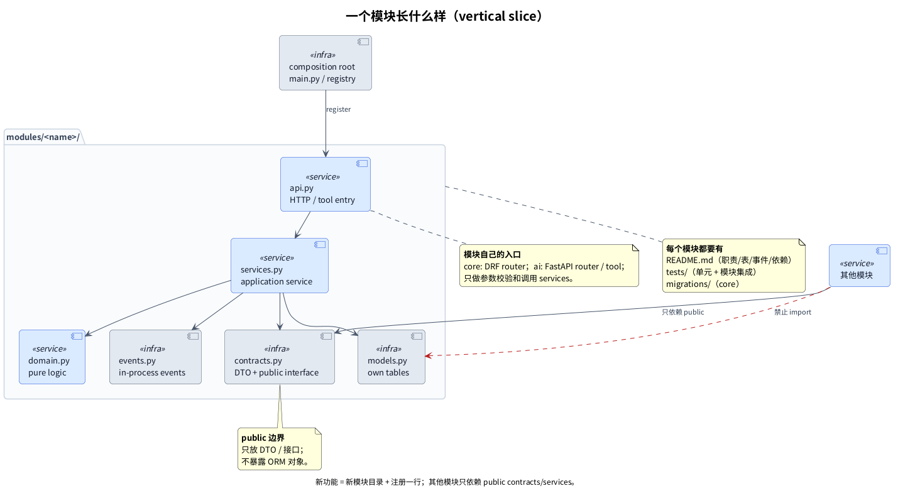

# MyHomePlus Architecture

> A family platform architecture built by **one person + AI**, designed to stay small enough to maintain and modular enough to grow.
>
> 3 programs · 1 PostgreSQL · 1 business write path · modular monolith.

**Status**: architecture v0.2 complete; implementation starts at P0. This is a design showcase, not a production deployment.



## What it is

MyHomePlus covers four family capabilities:

| Capability | What it answers | Program |
|---|---|---|
| Resource | What do we have, where is it, what expires, what to eat | `home-core` (Django) |
| Perception | What is in this photo/receipt/recipe | `home-ai` (FastAPI) |
| Knowledge | Why / how / is this trustworthy | `home-ai` (FastAPI + LlamaIndex) |
| Agent | Help me get this done | `home-ai` (pi-agent + tools) |

`home-web` (Next.js) is the UI. The platform is designed for a single household, a home server, and Docker Compose—not for multi-tenant SaaS.

## Why 3 programs

```text
home-web
   │ REST / SSE
   ├──────────────► home-core (Django, system of record)
   └──────────────► home-ai   (FastAPI, AI modules)
                         │
                         └── read / draft commit via core API
```

- **`home-core`**: transactional CRUD, admin, data ownership. Business data has exactly one write path.
- **`home-ai`**: intake, knowledge, tools, agent. It only writes its own schema; it cannot write `core` directly.
- **`home-web`**: UI, approvals, draft review, generated API client.

Four domains do **not** mean four services. Intake / knowledge / agent start as modules inside `home-ai`; they can be extracted later without rewriting their contracts.

## Design principles

1. **Modular monolith before microservices.** Modules are vertical slices; new features are new modules, not edits to existing domains.
2. **Single writer.** Business data is written only through `home-core` API; AI produces drafts and owns its own state.
3. **Knowledge is read-only.** The RAG index is rebuildable and never the source of truth.
4. **AI output is a draft.** Recognition/agent writes require confirmation; duplicate submissions are idempotent.
5. **Contracts first.** Public module interfaces + OpenAPI + generated clients; no cross-module ORM leakage.
6. **Boring infrastructure.** One PostgreSQL, two schemas, local disk; Redis/MinIO/Caddy only when a real need appears.
7. **Small is a feature.** No API gateway, LLM gateway, event bus, Kubernetes, or multi-tenant layer at this stage.

## Diagrams

| # | Diagram | Question |
|---|---|---|
| 01 | [Overall](diagrams/01-overall.puml) | What are the 3 programs and where do modules live? |
| 02 | [home-core modules](diagrams/02-core-modules.puml) | How do resource modules depend on each other? |
| 03 | [home-ai modules](diagrams/03-ai-modules.puml) | How do intake/knowledge/tools/agent stay decoupled? |
| 04 | [Write path](diagrams/04-write-path.puml) | Who can write, and what is forbidden? |
| 05 | [Data ownership](diagrams/05-data-ownership.puml) | Which schema owns which tables? |
| 06 | [Deployment](diagrams/06-deployment.puml) | What runs on the home server? |
| 07 | [Module anatomy](diagrams/07-module-anatomy.puml) | What does a module look like? |
| 08 | [Roadmap](diagrams/08-roadmap.puml) | What to build first, and what is deliberately later? |





## Documentation

- [`docs/00-glossary.md`](docs/00-glossary.md) — plain-language glossary (schema, API, DTO, RAG, idempotency…)
- [`docs/01-overview.md`](docs/01-overview.md) — goals, constraints, modules, data ownership, contracts
- [`docs/02-modules.md`](docs/02-modules.md) — module template, boundaries, growth playbook
- [`docs/03-decisions.md`](docs/03-decisions.md) — key decisions and tradeoffs
- [`docs/04-highlights.md`](docs/04-highlights.md) — design highlights: what was chosen and what it costs
- [`docs/05-family-scenarios.md`](docs/05-family-scenarios.md) — real family scenarios and the MVP loop
- [`docs/06-module-topics.md`](docs/06-module-topics.md) — module topic map and priorities
- [`docs/07-reference-index.md`](docs/07-reference-index.md) — official/community references
- [`docs/08-existing-software.md`](docs/08-existing-software.md) — what to learn / reuse / avoid from existing tools
- [`docs/09-anti-overengineering.md`](docs/09-anti-overengineering.md) — complexity budget and AI-coding rules
- [`docs/11-development-standards.md`](docs/11-development-standards.md) — development workflow, AI limits, and completion rules
- [`AGENTS.md`](AGENTS.md) — how a code agent should work inside these boundaries

## What is deliberately not here

- Multi-tenant SaaS, billing, public registration
- RBAC/OIDC/JWT/user tables (Phase 1: LAN/VPN + shared token)
- Kubernetes, service mesh, event bus, API/LLM gateway
- Formal approval workflow, SLA, on-call, large observability stack
- A second full application (Mealie/Tandoor/Grocy) as a runtime dependency

These are current-scope decisions, not claims that they are impossible. The cost/benefit and the upgrade triggers are documented in [`docs/03-decisions.md`](docs/03-decisions.md).

## Render

```bash
make render   # SVG + PNG into build/ (Kroki, no Java required)
make check    # validate PlantUML only
```

The generated `build/` directory is ignored; selected PNGs are committed under `docs/images/` for README preview.

## Scope of this repository

This repository contains architecture documents, PlantUML sources, and the render script only.

It contains **no real family data, credentials, personal notes, or third-party screenshots**. Examples are generic or fictional.

## License

Documentation and diagrams are shared for viewing and discussion. Add a license before redistributing or reusing substantial parts.
