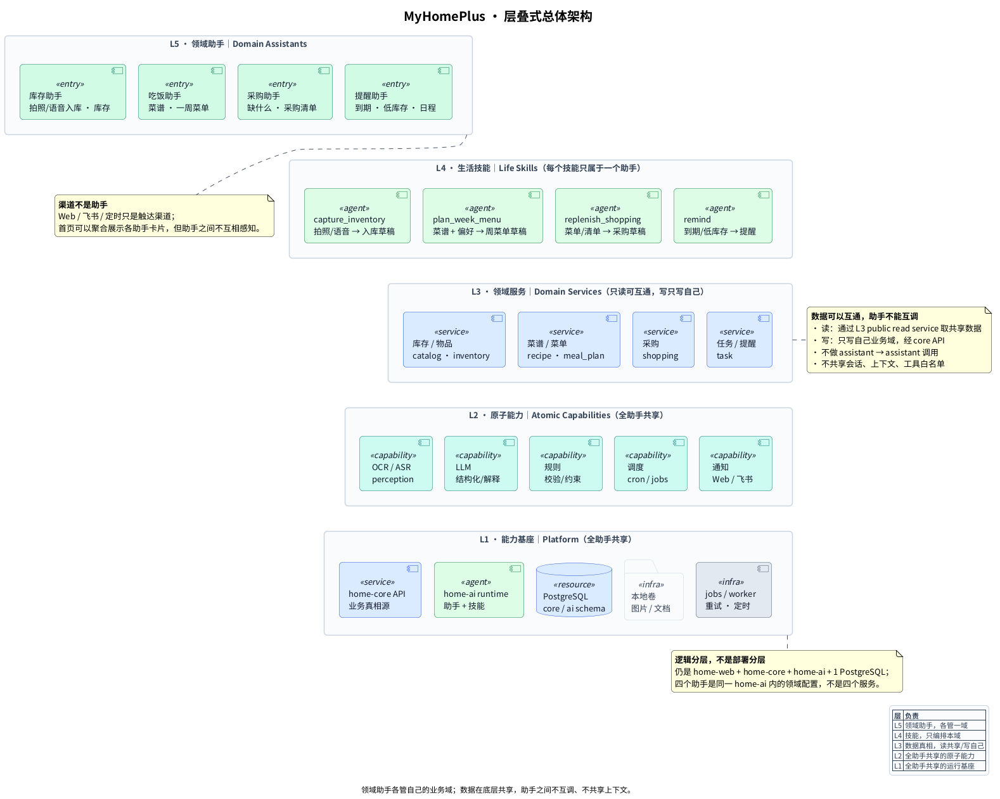
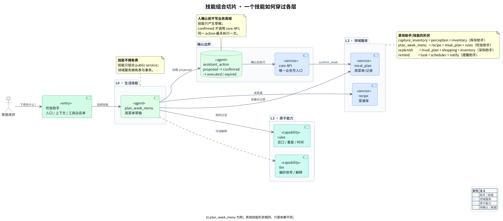
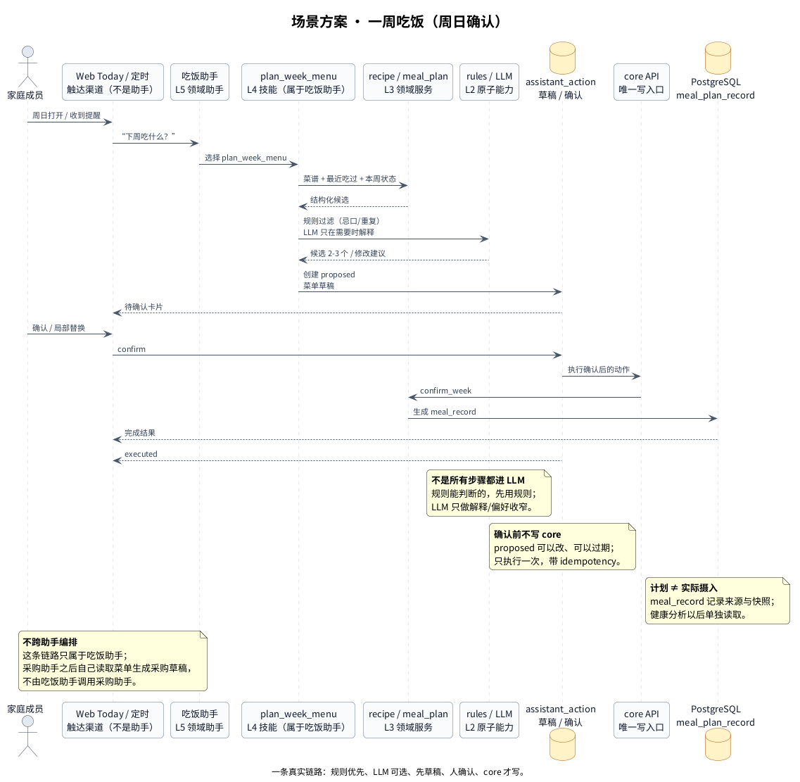

# MyHomePlus Architecture

> **A lightweight AI life assistant — capabilities broad, permissions narrow, the final step stays human.**
>
> One person + AI · 3 deployable programs · 1 PostgreSQL · 1 business write path · modular monolith.

**Status (2026-11)**: P2.4 kitchen web is working manually: recipes, weekly multi-dish meal plans, immutable meal records, and a dynamic shopping list. AI currently covers local OCR/ASR and structured intake drafts; the domain-assistant runtime is designed but not implemented. This is a working personal project and architecture showcase, not a production service.



## What changed

The project is no longer framed as a generic “smart home management platform”. It is a **lightweight AI life assistant** built from reusable capabilities and composable life skills.

```text
L5  Domain assistants    Inventory · Meal · Shopping · Reminder
L4  Life skills          Each skill belongs to exactly one assistant
L3  Domain services      Shared reads; writes stay inside the owning domain
L2  Atomic capabilities  OCR/ASR · LLM · rules · scheduler · notifications
L1  Platform base        home-core · home-ai runtime · PostgreSQL · files · jobs
```

The layered view is a **composition view**, not a deployment view. The runtime is still 3 programs.

## Four domain assistants

| Assistant | Owns | Does not own |
|---|---|---|
| Inventory | capture, stock, locations | recipes, menus, shopping |
| Meal | recipes, weekly meal plans, meal records | stock writes, shopping writes |
| Shopping | dynamic purchase list | inventory deduction |
| Reminder | tasks, due/low-stock reminders | domain data changes |

Rules:

- assistants **do not call each other**;
- they do not share conversations, context, or tool allowlists;
- they may read shared data through domain read contracts;
- writes stay in the owning domain and go through the core API;
- the home screen may aggregate cards from several assistants, but that is UI aggregation, not mutual awareness;
- cross-domain actions are explicit user switches; no hidden orchestration.

See [`docs/12-assistant-architecture.md`](docs/12-assistant-architecture.md).

## Why 3 programs

```text
home-web (Next.js)
   │ REST / SSE
   ├──────────────► home-core (Django, system of record)
   └──────────────► home-ai   (FastAPI, perception + AI + assistants)
                         │
                         └── read / propose via core API
```

- **`home-core`**: transactional CRUD, admin, data ownership. Business data has exactly one write path.
- **`home-ai`**: local perception, structured LLM output, future assistant/skill runtime. It only writes its own schema; it cannot write `core` directly.
- **`home-web`**: assistant workspace, draft review, confirmations, management drill-downs.

The four assistants are logical domains inside `home-ai`, **not four services**.

## What is implemented

| Area | Current state |
|---|---|
| Inventory | catalog, append-only movements, quick add, low stock, admin |
| Intake | photo/voice → local OCR/ASR → DeepSeek JSON draft → human confirmation |
| Recipes | title, servings, JSON ingredients/steps/tags; 37 legacy recipes imported |
| Meal plans | one week per row, 1–7 days, multiple dishes per meal, draft/edit/confirm, immutable meal records |
| Shopping | dynamic free-text list, manual add, done state, generate from a meal week; never touches inventory |
| Web | `/kitchen` hub: weekly menu, recipes, shopping |

Current numbers:

- 3 deployable programs, 1 PostgreSQL;
- 24 automated tests (core 15 / web 5 / ai 4);
- 10 real intake samples (5 images + 5 voice);
- 37 imported recipes / 249 ingredients;
- 11 PlantUML diagrams.

Known gaps are documented honestly: no auth/multi-tenant, no production observability, no assistant runtime yet, legacy recipes have no steps, and there is no reliable “cooked history” in the old data.

## Design principles

1. **Modular monolith before microservices.** Modules are vertical slices.
2. **Single writer.** Business data is written only through `home-core` API; AI produces drafts and owns its own state.
3. **Human confirmation is part of the product.** AI errors must not pollute the source of truth; repeated submissions are idempotent.
4. **Capabilities are shared; assistants are isolated.** One OCR/LLM stack, four domain-scoped assistants.
5. **Skills are not modules.** A skill composes domain services; only a persistent domain gets a module.
6. **Contracts first.** Public module interfaces + OpenAPI + generated clients; no cross-module ORM leakage.
7. **Boring infrastructure.** One PostgreSQL, two schemas, local disk; Redis/MinIO/Caddy only when a real need appears.
8. **Small is a feature.** No API gateway, LLM gateway, event bus, Kubernetes, multi-agent runtime, or vector database at this stage.

## Diagrams

| # | Diagram | Question |
|---|---|---|
| 00 | [Layered overview](diagrams/00-layered-overview.puml) | How do capabilities become skills and assistants? |
| 01 | [System context](diagrams/01-overall.puml) | What are the 3 programs and where do modules live? |
| 02 | [home-core modules](diagrams/02-core-modules.puml) | How do domain modules depend on each other? |
| 03 | [home-ai modules](diagrams/03-ai-modules.puml) | How do assistants, skills, tools, and capabilities stay decoupled? |
| 04 | [Write path](diagrams/04-write-path.puml) | Who can write, and what is forbidden? |
| 05 | [Data ownership](diagrams/05-data-ownership.puml) | Which schema owns which tables? |
| 06 | [Deployment](diagrams/06-deployment.puml) | What runs on the home server? |
| 07 | [Module anatomy](diagrams/07-module-anatomy.puml) | What does a module look like? |
| 08 | [Roadmap](diagrams/08-roadmap.puml) | Which scenario loops come first? |
| 09 | [Skill composition](diagrams/09-skill-composition.puml) | How does one skill cross the layers? |
| 10 | [Weekly meal scenario](diagrams/10-scenario-weekly-menu.puml) | How does one real flow run end to end? |





## Documentation

- [`docs/00-glossary.md`](docs/00-glossary.md) — plain-language glossary
- [`docs/01-overview.md`](docs/01-overview.md) — goals, constraints, modules, data ownership, contracts
- [`docs/02-modules.md`](docs/02-modules.md) — module template, boundaries, growth playbook
- [`docs/03-decisions.md`](docs/03-decisions.md) — key decisions and tradeoffs
- [`docs/04-highlights.md`](docs/04-highlights.md) — design highlights
- [`docs/05-family-scenarios.md`](docs/05-family-scenarios.md) — family scenarios and the MVP loop
- [`docs/06-module-topics.md`](docs/06-module-topics.md) — module topic map
- [`docs/11-development-standards.md`](docs/11-development-standards.md) — development workflow and AI limits
- [`docs/12-assistant-architecture.md`](docs/12-assistant-architecture.md) — layered assistant model and boundaries
- [`AGENTS.md`](AGENTS.md) — how a code agent should work inside these boundaries

## What is deliberately not here

- Multi-tenant SaaS, billing, public registration
- RBAC/OIDC/JWT/user tables (Phase 1: LAN/VPN + shared token)
- Kubernetes, service mesh, event bus, API/LLM gateway
- Multi-agent orchestration or autonomous execution
- Formal approval workflow, SLA, on-call, large observability stack
- A second full application (Mealie/Tandoor/Grocy) as a runtime dependency

These are current-scope decisions, not claims that they are impossible. Costs and upgrade triggers are documented in [`docs/03-decisions.md`](docs/03-decisions.md).

## Render

```bash
make render   # SVG + PNG into build/ (Kroki, no Java required)
make check    # validate PlantUML only
```

The generated `build/` directory is ignored; selected PNGs are committed under `docs/images/` for README preview.

## Scope of this repository

This repository contains architecture documents, PlantUML sources, and the render script only.

It contains **no real family data, credentials, personal notes, or third-party screenshots**. Examples are generic or fictional.

## License

Documentation and diagrams are shared for viewing and discussion. Add a license before redistributing or reusing substantial parts.
